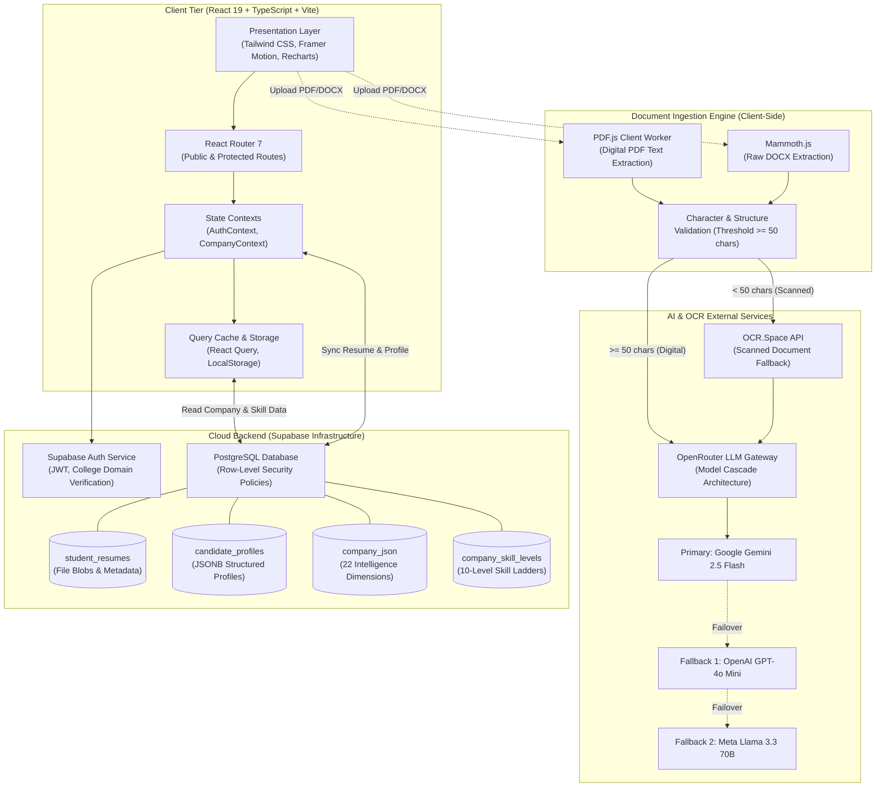
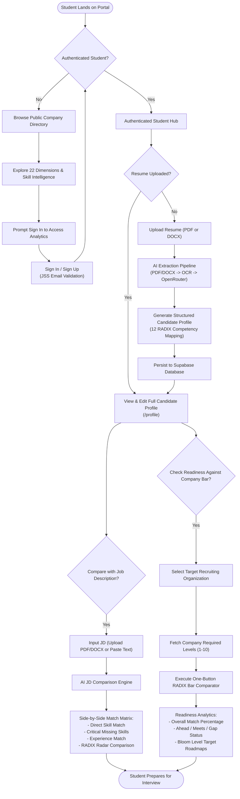
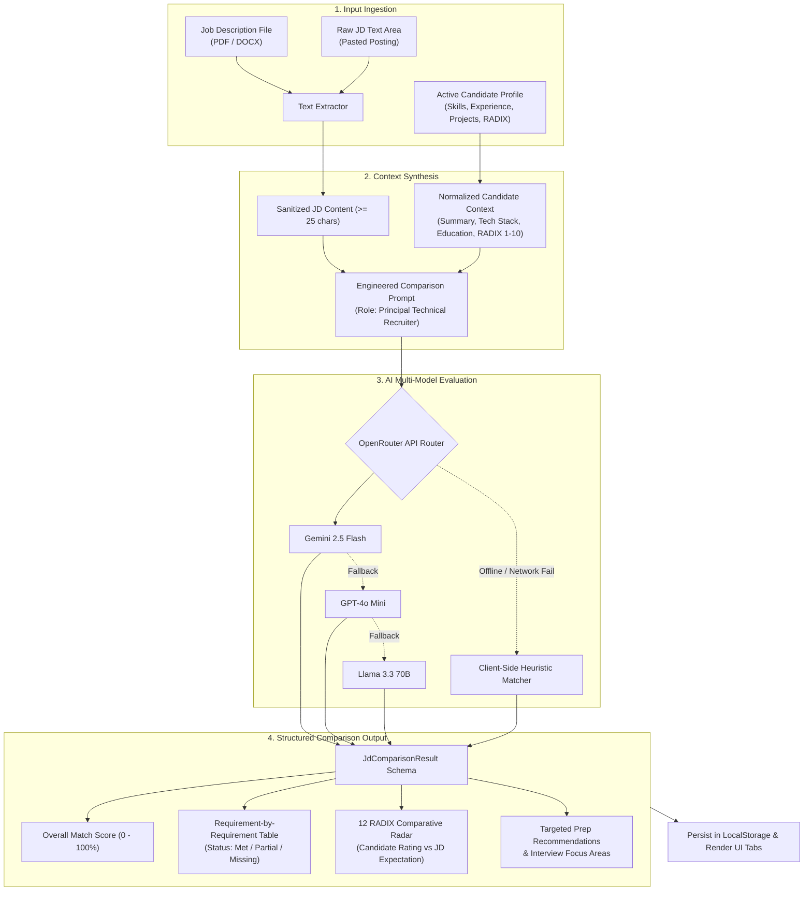
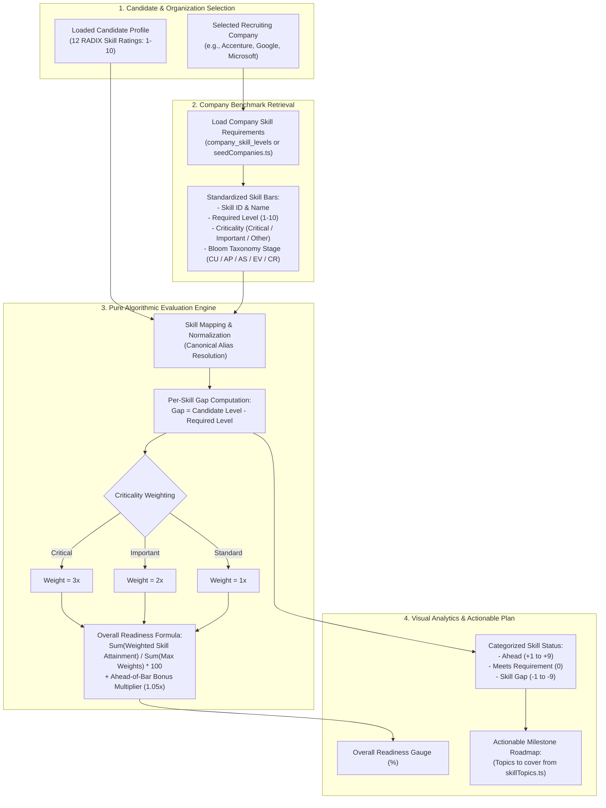
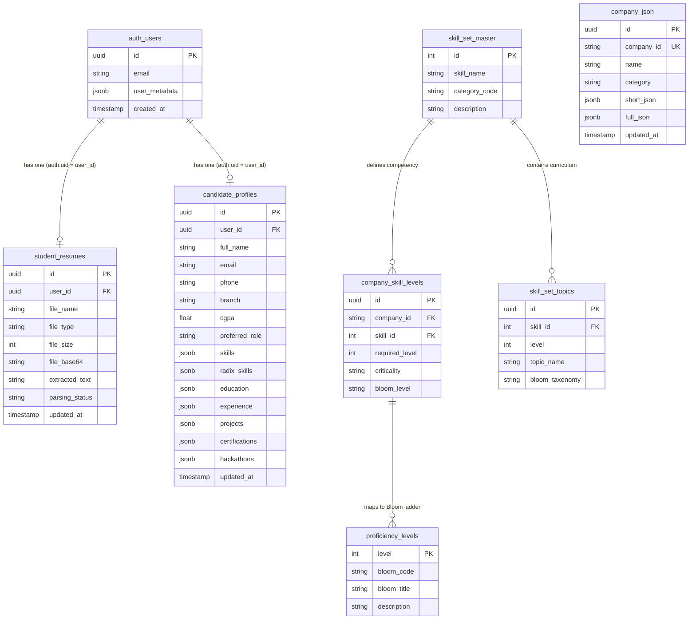
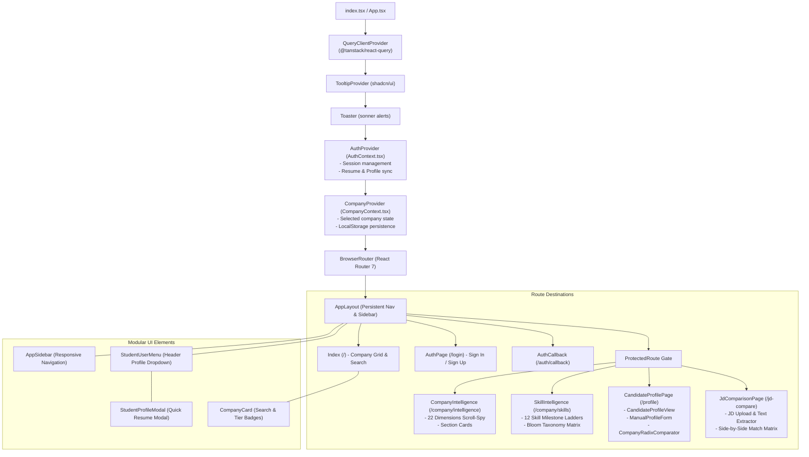

# JSS University Placement Intelligence Hub
> **Next-Generation Campus Recruitment Analytics, AI Resume Parsing, JD Match Intelligence & RADIX Benchmark Platform**

[](https://vitejs.dev/)
[](https://react.dev/)
[](https://www.typescriptlang.org/)
[](https://tailwindcss.com/)
[](https://supabase.com/)
[](https://vitest.dev/)
[](#license)

---

## Table of Contents
1. [Overview](#executive-overview)
2. [Core Architectural Highlights](#core-architectural-highlights)
3. [System Architecture Diagram](#system-architecture-diagram)
4. [End-to-End User Journey & Workflow](#end-to-end-user-journey--workflow)
5. [AI Resume Extraction & 12 RADIX Parsing Pipeline](#ai-resume-extraction--12-radix-parsing-pipeline)
6. [Job Description (JD) Comparison Engine](#job-description-jd-comparison-engine)
7. [Company RADIX Bar Comparator & Readiness Engine](#company-radix-bar-comparator--readiness-engine)
8. [Database Schema & Supabase Architecture](#database-schema--supabase-architecture)
9. [Component & Provider Hierarchy](#component--provider-hierarchy)
10. [The 12 RADIX Competency Framework & Bloom's Taxonomy](#the-12-radix-competency-framework--blooms-taxonomy)
11. [The 22 Dimensions of Company Intelligence](#the-22-dimensions-of-company-intelligence)
12. [Tech Stack & Dependencies](#tech-stack--dependencies)
13. [Project Directory Structure](#project-directory-structure)
14. [Local Development & Setup Guide](#local-development--setup-guide)
15. [Environment Variables Reference](#environment-variables-reference)
16. [Testing & Quality Assurance](#testing--quality-assurance)
17. [Security & Privacy Compliance](#security--privacy-compliance)

---

## Executive Overview

**JSS University Placement Intelligence Hub** is an enterprise-grade Single Page Application (SPA) designed to empower students and campus placement teams with data-driven recruitment intelligence. The platform bridges the divide between candidate preparation and company expectations through:

- **22-Dimension Corporate Profiles**: Deep research on recruiting organizations spanning identity, culture, financial standing, tech stack, and risk.
- **10-Level Technical Competency Ladders**: Skill benchmarks aligned with Bloom's Taxonomy (CU to CR) across 12 standardized domain skillsets.
- **Multi-Modal AI Resume Parsing**: Client-side document ingestion (PDF/DOCX) with automatic OCR fallback, LLM schema extraction, and automatic mapping into 12 RADIX skills.
- **Real-Time Job Description (JD) Gap Analytics**: Intelligent side-by-side matching of student competencies against custom JD requirements with actionable delta indicators.
- **One-Button Company RADIX Bar Comparator**: Algorithmic evaluation comparing a student's profile directly against a company's required threshold, computing overall readiness percentages and actionable gap-closing roadmaps.

---

## Core Architectural Highlights

| Pillar | Implementation | Key Benefits |
|---|---|---|
| **Zero-Lag Client SPA** | React 19 + Vite 8 + TanStack React Query 5 | Blazing fast client rendering, stale-while-revalidate data fetching, and optimistic state updates. |
| **Authentication & Access** | Supabase Auth with JSS University Domain Verification | Strict email validation ensuring campus identity integrity while supporting password, OTP, and magic links. |
| **Multi-Engine Ingestion** | PDF.js + Mammoth + OCR.Space API | Handles digital PDFs, Word DOCX files, and scanned documents seamlessly. |
| **LLM Model Cascade** | OpenRouter Gateway (Gemini 2.5 Flash -> GPT-4o-mini -> Llama 3.3 70B) | High availability and cost-effective AI extraction with zero-latency fallback heuristics. |
| **Persistence Layer** | PostgreSQL + Row-Level Security (RLS) + Encrypted JSONB | Student profiles and resumes isolated by `auth.uid() = user_id`, alongside cached company JSON intelligence. |

---

## System Architecture Diagram

The portal employs a modern decoupled architecture where the React SPA orchestrates client-side document processing, queries Supabase for data and authentication, and connects to AI microservices via secure gateway routers.



---

## End-to-End User Journey & Workflow

The following flowchart outlines the entire student experience—from initial campus authentication to discovering target recruiting companies, building an AI-backed profile, and running gap comparisons against specific job descriptions or target companies.



---

## AI Resume Extraction & 12 RADIX Parsing Pipeline

The resume ingestion system employs a resilient multi-tier pipeline capable of extracting structured profile information even from legacy formatting or image-based scans.

```mermaid
flowchart LR
    File["Resume File\n(PDF or DOCX)"] --> FormatDetect{"File Format?"}

    FormatDetect --".pdf"--> PDFJS["PDF.js Parser\n(extract page text blocks)"]
    FormatDetect --".docx"--> Mammoth["Mammoth.js\n(extract raw paragraphs)"]

    PDFJS --> QualityCheck{"Extracted Text\nLength >= 50?"}
    Mammoth --> QualityCheck

    QualityCheck --"No (Scanned/Flattened)"--> OCR["OCR.Space API Engine\n(Optical Character Recognition)"]
    QualityCheck --"Yes (Digital)"--> PromptBuilder["Construct Structured AI Prompt"]
    OCR --> PromptBuilder

    PromptBuilder --> LLMCascade{"OpenRouter Gateway\nFallback Cascade"}

    LLMCascade -->|"Attempt 1"| Model1["Google Gemini 2.5 Flash\n(Ultra Fast, High Reasoning)"]
    Model1 -.->|"On Failure / Timeout"| Model2["OpenAI GPT-4o Mini\n(Reliable Structural Parser)"]
    Model2 -.->|"On Failure / Timeout"| Model3["Meta Llama 3.3 70B\n(Open-Weight Engine)"]

    Model1 & Model2 & Model3 --> JSONValidation{"Validate JSON Schema"}

    JSONValidation --"Pass"--> ProfileObject["Structured Candidate Profile:\n- Education & CGPA\n- Technical Skills\n- Work Experience & Projects\n- Certifications & Hackathons\n- 12 RADIX Category Scores (1-10)"]
    JSONValidation --"Fail"--> FallbackHeuristic["Local Regex Heuristic Fallback"]
    FallbackHeuristic --> ProfileObject

    ProfileObject --> PersistDB[("Supabase: candidate_profiles\n& student_resumes")]
```



---

## Job Description (JD) Comparison Engine

The JD comparison engine provides students with immediate, actionable feedback on how their verified credentials stack up against any specific campus job opening.



---

## Company RADIX Bar Comparator & Readiness Engine

Unlike generic string-matching matching algorithms, the **Company RADIX Bar Comparator** performs deterministic, weighted mathematical gap analysis between a candidate's competency levels (1–10) and an organization's specific technical requirements derived from real placement intelligence.



### Readiness Mathematical Formulation

$$\text{Skill Attainment}_i = \min\left(1.0, \frac{\text{Candidate Level}_i}{\text{Required Level}_i}\right) \times \begin{cases} 1.05 & \text{if Candidate Level}_i > \text{Required Level}_i \\ 1.00 & \text{otherwise} \end{cases}$$

$$\text{Overall Readiness} = \left( \frac{\sum_{i=1}^{N} \left( \text{Skill Attainment}_i \times \text{Weight}_i \right)}{\sum_{i=1}^{N} \text{Weight}_i} \right) \times 100$$

Where $\text{Weight}_i = 3$ for **Critical**, $2$ for **Important**, and $1$ for standard skills.

---

## Database Schema & Supabase Architecture

The database architecture partitions candidate private data from campus corporate intelligence, governed by PostgreSQL Row-Level Security (RLS) policies.



---

## Component & Provider Hierarchy



---

## The 12 RADIX Competency Framework & Bloom's Taxonomy

Every student profile and company requirement is calibrated against **12 RADIX Technical Domains** across **5 Bloom's Taxonomy Cognitive Levels**.

### The 12 RADIX Competencies

| Code | Canonical Domain | Key Evaluated Topics |
|---|---|---|
| **DSA** | Data Structures & Algorithms | Arrays, Trees, Dynamic Programming, Graphs, Complexity Analysis |
| **COD** | Core Programming | Syntax, Pointers, Memory Management, Idiomatic Best Practices |
| **OOD** | Object-Oriented Design | SOLID Principles, Design Patterns, Modularity, Inheritance |
| **SQL** | Database Management & SQL | Relational Design, Normalization, Indexing, Transactions, ACID |
| **SYSD**| System Design | Scalability, Load Balancing, Caching, Microservices, Message Queues |
| **CLOUD**| Cloud Computing & DevOps | AWS/GCP, Docker, Kubernetes, CI/CD Pipelines, Serverless |
| **OS**  | Operating Systems | Concurrency, Memory Management, Threads, Deadlocks, File Systems |
| **NETW**| Computer Networks | TCP/IP, HTTP/HTTPS, DNS, WebSockets, Network Security |
| **SWE** | Software Engineering | Git, Unit Testing, Agile, Code Review, Refactoring |
| **AI**  | Artificial Intelligence & GenAI | ML Algorithms, Neural Networks, LLMs, Prompt Engineering, RAG |
| **APTI**| Analytical & Quantitative Aptitude | Logical Reasoning, Numerical Analysis, Critical Problem Solving |
| **COMM**| Professional Communication | Technical Articulation, Collaboration, Documentation, Presentation |

### The Bloom's Taxonomy Cognitive Scale

```
Level 9-10: CR  [Creative Innovation]        --> Architecting novel distributed frameworks
Level 7-8:  EV  [Evaluative Architecture]   --> Trade-off analysis, benchmark optimization
Level 5-6:  AS  [Analytical Synthesis]      --> Multi-system integration & debugging
Level 3-4:  AP  [Applied Problem Solving]   --> Production implementation & API creation
Level 1-2:  CU  [Conceptual Understanding]   --> Core syntax, terminology & fundamentals
```

---

## The 22 Dimensions of Company Intelligence

The portal aggregates company research across 22 structured dimensions:

```
├── 01. Company Identity            ├── 12. Culture & Work Life
├── 02. Overview & Vision           ├── 13. Recent News & Milestones
├── 03. Leadership & Governance     ├── 14. Sales & Customer Metrics
├── 04. Funding & Financials        ├── 15. Risk & Compliance
├── 05. Global Presence & Centers   ├── 16. Work Location & Commute
├── 06. Products & Services         ├── 17. Safety & Wellbeing
├── 07. Technology Stack            ├── 18. Career Growth & Learning
├── 08. Partnerships & Ecosystem    ├── 19. Brand & Reputation
├── 09. Competitive Landscape       ├── 20. Compensation & Benefits Policy
├── 10. Market Opportunity          ├── 21. Digital Presence & Ratings
└── 11. Core Value Proposition      └── 22. Contact & Campus Relations
```

---

## Tech Stack & Dependencies

### Core Frameworks
- **React 19.3.1**: Next-generation React library with enhanced concurrent features and state primitives.
- **Vite 8.3.4**: Lightning-fast ES-module bundler and dev server.
- **TypeScript 6.0.3**: Type-safe engineering across data models, schemas, and API responses.
- **React Router 7.18.4**: Route architecture with nested layouts and protection guards.
- **@tanstack/react-query 5.104.5**: Asynchronous cache management and optimistic mutation handling.

### Styling & UI
- **Tailwind CSS 3.4.19**: Utility-first styling with customized corporate palette tokens.
- **Framer Motion 14.5.0**: Fluid UI animations, layout transitions, and micro-interactions.
- **Lucide React 1.60.0**: Comprehensive modern icon library.
- **Recharts 3.10.1**: Interactive radar charts, readiness gauges, and analytics visualizations.
- **Sonner 2.0.8**: Clean toast notification ecosystem.

### Ingestion & Machine Intelligence
- **pdfjs-dist 6.4.299**: WebWorker-backed PDF text extraction.
- **mammoth 1.13.0**: DOCX document conversion into structured plain text.
- **OpenRouter API**: Unified multi-provider LLM endpoint (Gemini, GPT-4o-mini, Llama 3.3).
- **OCR.Space API**: Cloud OCR engine for scanned, image-heavy candidate resumes.

### Backend Infrastructure
- **@supabase/supabase-js 2.118.0**: PostgreSQL database client and authentication management.

---

## Project Directory Structure

```
ui-fri-placement/
├── public/                       # Static public assets
├── src/
│   ├── components/               # React UI Components
│   │   ├── auth/                 # Authentication & authorization
│   │   │   ├── ProtectedRoute.tsx
│   │   │   └── StudentUserMenu.tsx
│   │   ├── layout/               # Shell layout & responsive chrome
│   │   │   ├── AppLayout.tsx
│   │   │   └── AppSidebar.tsx
│   │   ├── profile/              # Candidate profile & analytics widgets
│   │   │   ├── CandidateProfileView.tsx
│   │   │   ├── CompanyRadixComparator.tsx
│   │   │   ├── ManualProfileForm.tsx
│   │   │   └── StudentProfileModal.tsx
│   │   ├── ui/                   # Primitive design components (shadcn)
│   │   ├── Badges.tsx            # Category & status badges
│   │   ├── CompanyCard.tsx       # Directory listing card
│   │   ├── CompanyLogo.tsx       # Robust company avatar
│   │   └── FieldRow.tsx          # Key-value intelligence viewer
│   ├── context/                  # Global React Contexts
│   │   ├── AuthContext.tsx       # Auth session & profile state
│   │   └── CompanyContext.tsx    # Selected company state
│   ├── data/                     # Intelligence seed & taxonomy data
│   │   ├── intelligenceData.tsx  # 22-section schema definitions
│   │   ├── seedCompanies.ts      # Offline fallback dataset
│   │   └── skillTopics.ts        # 10-level competency curriculums
│   ├── lib/                      # Business Logic & Service Clients
│   │   ├── authUtils.ts          # Email validation & student extraction
│   │   ├── companyApi.ts         # Supabase data retrieval
│   │   ├── companyData.ts        # Schema normalization helpers
│   │   ├── companyRadixComparisonService.ts # Algorithmic bar comparator
│   │   ├── jdComparisonService.ts# AI Job Description comparison
│   │   ├── resumeParserService.ts# Document text extraction & LLM parsing
│   │   ├── resumeService.ts      # Resume storage & Supabase sync
│   │   ├── supabaseClient.ts     # Supabase client instantiation
│   │   └── utils.ts              # Styling & class merging utils
│   ├── pages/                    # Route Page Components
│   │   ├── AuthCallback.tsx      # Supabase OAuth/magic link callback
│   │   ├── AuthPage.tsx          # Student login and registration
│   │   ├── CandidateProfilePage.tsx # Profile view & comparator
│   │   ├── CompanyIntelligence.tsx  # 22-dimension research
│   │   ├── Index.tsx             # Recruiting company directory
│   │   ├── JdComparisonPage.tsx  # JD comparison analytics
│   │   ├── NotFound.tsx          # Custom 404 page
│   │   └── SkillIntelligence.tsx    # 12-skill competency ladders
│   ├── test/                     # Unit & Integration Tests (Vitest)
│   │   ├── auth.test.ts
│   │   ├── companyRadixComparison.test.tsx
│   │   ├── jdComparison.test.tsx
│   │   ├── resume.test.ts
│   │   ├── resumeParser.test.ts
│   │   └── smoke.test.tsx
│   └── types/                    # TypeScript Data Interfaces
│       ├── candidateProfile.ts
│       ├── companyRadixComparison.ts
│       ├── jdComparison.ts
│       └── resume.ts
├── supabase/
│   └── migrations/               # PostgreSQL schema migrations
├── index.html                    # HTML entry point
├── package.json                  # Dependencies & scripts
├── tailwind.config.js            # Tailwind theme tokens
├── tsconfig.json                 # TypeScript project configuration
└── vite.config.ts                # Vite build plugins & aliases
```

---

## Local Development & Setup Guide

### Prerequisites
- **Node.js**: v18.0.0 or higher
- **npm**: v9.0.0 or higher

### Installation Steps

1. **Clone the Repository**:
   ```bash
   git clone https://github.com/MaanasVerma25/Placement-Portal.git
   cd Placement-Portal
   ```

2. **Install Dependencies**:
   ```bash
   npm install
   ```

3. **Configure Environment Variables**:
   Create a `.env` file in the root directory:
   ```env
   VITE_SUPABASE_URL=https://your-supabase-project.supabase.co
   VITE_SUPABASE_ANON_KEY=your-supabase-anon-key
   VITE_OPENROUTER_API_KEY=your-openrouter-api-key
   VITE_OCR_SPACE_API_KEY=your-ocr-space-api-key
   ```

4. **Launch Local Development Server**:
   ```bash
   npm run dev
   ```
   Open `http://localhost:5173` in your browser.

5. **Execute Production Build**:
   ```bash
   npm run build
   ```

---

## Environment Variables Reference

| Variable | Required | Description | Example |
|---|---|---|---|
| `VITE_SUPABASE_URL` | Yes | Supabase Project URL | `https://xyzcompany.supabase.co` |
| `VITE_SUPABASE_ANON_KEY` | Yes | Supabase Anonymous Client Key | `eyJhbGciOi...` |
| `VITE_OPENROUTER_API_KEY` | Recommended | AI Gateway Key for Gemini/GPT-4 parsing | `sk-or-v1-...` |
| `VITE_OCR_SPACE_API_KEY` | Optional | Fallback OCR key for scanned PDFs | `K8899001122...` |

*(Note: If AI keys are not configured, the system gracefully falls back to local heuristic keyword parsing and static company seed data).*

---

## Testing & Quality Assurance

The codebase includes an automated test suite powered by **Vitest** and **React Testing Library**, covering authentication, resume parsing, JD analysis, and the 12 RADIX company readiness comparator.

To run the complete test suite:
```bash
npm test
```

### Test Coverage Highlights
- `src/test/auth.test.ts`: College domain verification, student roll extraction, session handling.
- `src/test/resumeParser.test.ts`: PDF/DOCX ingestion, fallback triggers, candidate profile normalization.
- `src/test/resume.test.ts`: Supabase database persistence, file size validation, cache deletion.
- `src/test/jdComparison.test.tsx`: JD text validation, LLM cascade failover, heuristic fallback execution.
- `src/test/companyRadixComparison.test.tsx`: Weighted readiness scoring, canonical alias matching, milestone breakdown.
- `src/test/smoke.test.tsx`: Core application routes, navigation, and layout smoke tests.

---

## Security & Privacy Compliance

1. **JSS Domain Isolation**: Enforced registration validation to verify students belong to authorized college branches.
2. **Row-Level Security (RLS)**: Candidate resumes, extracted text, and profile JSONB objects are restricted to the authenticated student's unique UUID (`auth.uid() = user_id`).
3. **Institutional Privacy**: In strict accordance with institutional placement guidelines, **no CTC, Stipend amounts, or confidential Selection Ratios** are exposed or stored anywhere in the platform.
4. **Client-Side Document Parsing**: Primary text extraction occurs directly within the client browser via WebWorkers (`pdfjs-dist`), reducing unnecessary server data transmission.

---

## License

This project is proprietary and confidential to **JSS University**. All rights reserved. Unauthorized reproduction, distribution, or decompilation is strictly prohibited.
